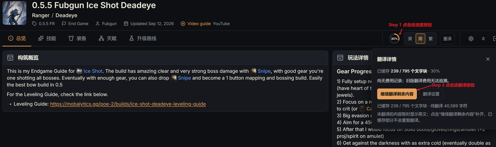

# poe2ultra

**English** · [简体中文](README.zh-CN.md)

poe2ultra is a Chrome extension for reading Path of Exile 2 build guides on [Mobalytics](https://mobalytics.gg/poe-2). It organizes guide content into focused panels and can translate guide text into Simplified and Traditional Chinese.

## Features

- Browse a guide through Overview, Skills, Gear, Passives and Atlas, and Progression panels.
- Switch between English, Simplified Chinese, and Traditional Chinese. Original text stays available beside translated content.
- Translate guides in batches, keep translations in a local cache, resume interrupted work, and retranslate individual text blocks.
- Preserve links, icons, and clickable entity details in supported rich-text guide content.
- Look up equipment through trade links, including Simplified Chinese searches on the China realm.
- Translate selected text on websites you allow in settings, using the floating button, `Alt+Q`, or the context menu.
- Configure translation providers, prompts, terminology, optional web lookup, diagnostics, and cost estimates.

## Install from GitHub Releases

Download the Chrome ZIP from the [latest release](https://github.com/JulianGuSM/poe2ultra/releases/latest).

To install the extension manually:

1. Unzip the downloaded package.
2. Open `chrome://extensions` and turn on **Developer mode**.
3. Choose **Load unpacked** and select the extracted folder that directly contains `manifest.json`.
4. Open or refresh a Mobalytics Path of Exile 2 guide.

When updating, replace the files in the existing extension folder and click **Reload** on its card. Keeping the same folder and extension entry preserves local settings and translation cache. Avoid running another extension that also takes over the same guide page.

## Configure translation

1. Open poe2ultra settings from the extension icon or the guide's settings control.
2. Add an API key and save your provider settings. DeepSeek is the default endpoint; compatible custom endpoints can be configured.
3. Return to a guide and start translation from the translation progress control. The extension creates both Chinese versions in batches.
   
4. Use the language switch to show or hide cached translations. Switching languages does not itself send a translation request.

Selection translation is opt-in by website. Add allowed URL patterns under **Selection & panel** in settings, save, then refresh the matching page. Automatic translation on text selection is off by default.

## Privacy

Translation settings and guide cache are stored in the browser profile. When you request translation, poe2ultra sends the relevant text and configured context to the translation provider you selected. Optional terminology services may receive lookup queries when enabled. Read the full [Privacy Notice](PRIVACY.md) before configuring a provider, and do not share cache backups or debug logs without reviewing their contents.

## Build from source

Requirements: Node.js and npm.

```sh
npm ci
npm run build
```

The unpacked Chrome extension is written to `.output/chrome-mv3`. To create a distributable Chrome package:

```sh
npm run zip:store
```

Packages are written under `.output/releases`. To rebuild the bundled terminology JSON from its CSV source, run `npm run build:poe2-terms`.

## More information

- [简体中文说明](README.zh-CN.md)
- [Changelog](CHANGELOG.md)
- [Privacy Notice](PRIVACY.md)
- [License](LICENSE)
- [Upstream project notes](docs/UPSTREAM-README.md)

poe2ultra is based on [ReSenpai/poe2perfect](https://github.com/ReSenpai/poe2perfect) and includes translation components and terminology data. See the [project notices](NOTICE) for attribution and licensing details.

## Support

If poe2ultra has been useful, you can scan the code below to support the project. Thank you!


